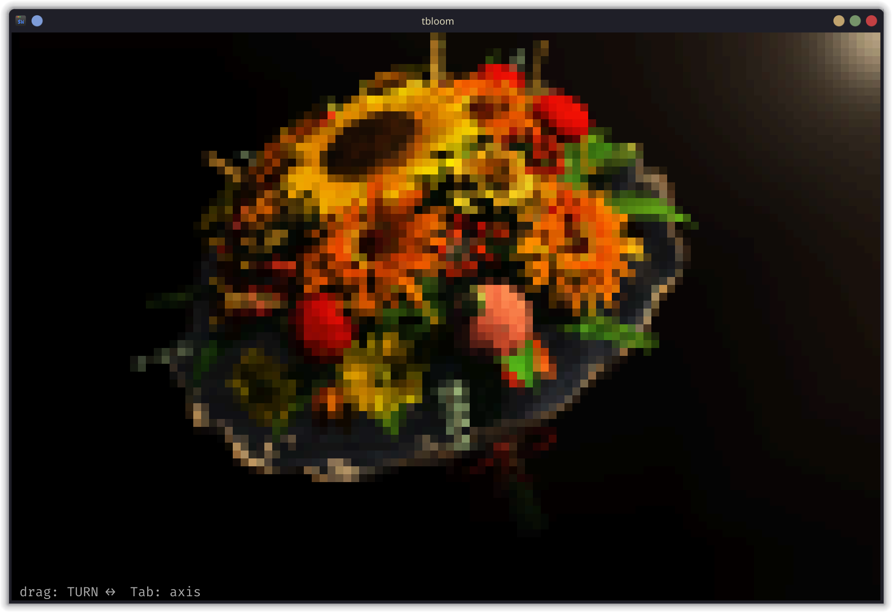
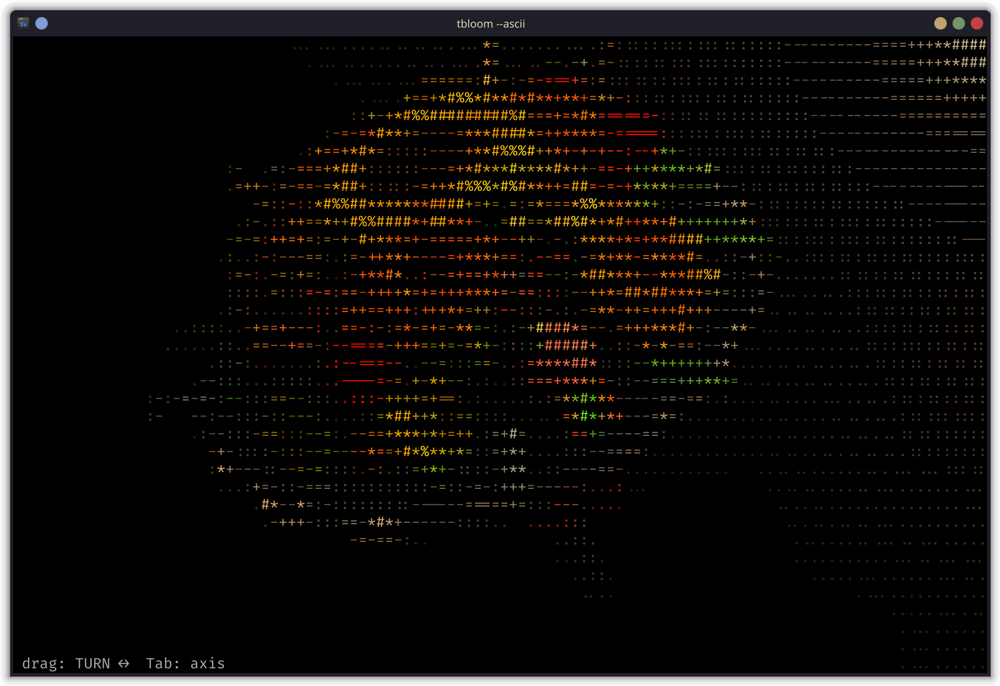

<h1 align="center">tbloom</h1>

<p align="center">A 3D bouquet in your terminal. Turn it with the mouse or the keyboard.</p>

<p align="center">
  
</p>

tbloom draws a 3D bouquet of flowers in the terminal. A software rasterizer makes each frame on the CPU.
The scene has a warm key light, soft shadows and a cool rim light.
tbloom can also show a model from an FBX file.

## Previews

<details>
<summary>Half blocks (default)</summary>

</details>

<details>
<summary>ASCII</summary>

</details>

## Requirements

- A terminal with 24-bit color and mouse support, for example WezTerm, kitty, foot or Alacritty.
- For `--nerd`: a font or terminal that draws the sextant characters (Unicode "Symbols for Legacy Computing"). WezTerm and kitty draw them without a special font.
- To build: a stable Rust toolchain for the 2024 edition, and a C compiler. The FBX library (ufbx) contains C code.

## Installation

Install tbloom with cargo:

```sh
cargo install --git https://github.com/sravioli/tbloom
```

## Usage

Start tbloom with sextant characters. This mode gives the most detail:

```sh
tbloom --nerd
```

If your terminal cannot draw sextant characters, start tbloom with the default half blocks:

```sh
tbloom
```

Show an FBX model:

```sh
tbloom --model path/to/model.fbx
```

Print one frame to the standard output and stop:

```sh
tbloom --snapshot 120x40 > frame.txt
```

### Options

| Option | Short | Function |
| --- | --- | --- |
| `--model <FILE>` | `-m` | Show a binary or ASCII FBX model. |
| `--nerd` | `-n` | Use sextant characters (2×3 pixels in each cell). |
| `--ascii` | `-a` | Use ASCII characters only. The colors stay, unless you also use `--no-color`. |
| `--no-color` | `-M` | Use no color. tbloom shows brightness with characters only. |
| `--aa` | `-A` | Anti-aliasing. When you stop the input, tbloom draws a smoother frame. |
| `--snapshot <WxH>` | `-s` | Print one frame of W × H cells, then stop. |
| `--help` | `-h` | Show the help. |

You cannot use `--nerd` and `--ascii` together.

### Controls

Each control turns the view about one fixed axis of the screen.

| Input | Function |
| --- | --- |
| <kbd>Tab</kbd> | Select the next axis for the mouse drag: turn, tilt, roll. |
| <kbd>1</kbd> <kbd>2</kbd> <kbd>3</kbd> | Select turn, tilt or roll directly. |
| Mouse drag | Turn the view about the selected axis. |
| <kbd>a</kbd> <kbd>d</kbd>, <kbd>←</kbd> <kbd>→</kbd> | Turn left or right. |
| <kbd>w</kbd> <kbd>s</kbd>, <kbd>↑</kbd> <kbd>↓</kbd> | Tilt up or down. |
| <kbd>A</kbd> <kbd>D</kbd> | Roll left or right. |
| Mouse wheel | Zoom in or out. |
| <kbd>r</kbd> | Reset the view. |
| <kbd>q</kbd>, <kbd>Ctrl</kbd>+<kbd>C</kbd> | Quit. |

The label at the bottom left shows the selected axis.

### FBX models

tbloom reads binary and ASCII FBX files. It moves the model to the center and sets its size to fill the view.
tbloom shows the rest pose only. It does not play animations.

tbloom finds textures in this sequence:

1. The path in the FBX file, relative to the FBX file.
2. The file name next to the FBX file.
3. The file name in `../textures` or `textures`, relative to the FBX file.

For each location, tbloom also tries the extensions `.png`, `.jpg` and `.jpeg`.
If tbloom cannot find a texture, it uses the material color and shows a warning.

## Development

Run the tests:

```sh
cargo test
```

Make the screenshots in `.github/assets`. This script needs KDE Plasma (spectacle) and WezTerm:

```sh
scripts/screenshots.sh
```

Do not use the desktop while the script runs. Each screenshot opens a window that must stay in front.

## License

Code: [GNU GPL v2](LICENSE). Documentation: [CC BY-NC 4.0](LICENSE-DOCS).
